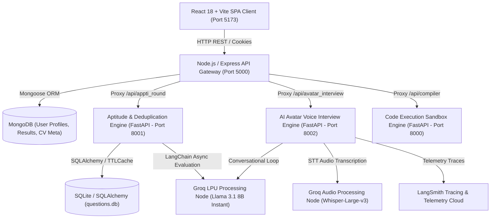

# PrepView Platform: Master Technical Specification, Architecture, Workflows & Research References

---

## 🏛️ 1. Executive Technical Summary

**PrepView** is a high-performance, event-driven microservices platform engineered for full-stack technical recruitment preparation, dynamic aptitude testing, voice-driven AI avatar mock interviews, and multi-language code compilation sandboxes.

The platform combines **transformer-based dense semantic vector embeddings**, **large language model (LLM) agentic workflows on deterministic hardware**, **Whisper speech-to-text audio models**, and **isolated native execution enclaves**.

---

## 🏗️ 2. Platform Topology & Microservice Networking

The core infrastructure operates via a **Centralized Node.js API Gateway** that terminates client traffic, manages stateful persistence (MongoDB), enforces token-based security, and reverse-proxies specialized execution workloads to isolated **Python FastAPI microservices**.

---

## 🧩 3. Comprehensive Segment Analysis

---

### Segment 1: AI Aptitude Test & Semantic Deduplication Engine (`appti_round`)

#### ⚙️ Pipeline Mechanics & Workflow
1. **Automated Scraping & Ingestion**: Web scrapers utilize `requests` and `BeautifulSoup4` to target educational platforms (e.g., IndiaBix). It extracts raw HTML question containers (`bix-div-container`), option rows (`bix-opt-row`), hidden answer tokens (`jq-hdnakq`), and explanation blocks (`bix-ans-description`).
2. **Dense Semantic Embedding**: Text strings are passed to Hugging Face's `all-MiniLM-L6-v2` transformer model (via `sentence-transformers`), mapping natural language text into a 384-dimensional dense vector space $\vec{v} \in \mathbb{R}^{384}$.
3. **Cosine Similarity Deduplication**: To prevent database pollution, incoming question embeddings ($\vec{a}$) are matched against existing database embeddings ($\vec{b}$) using cosine similarity:
   $$\text{Similarity}(\vec{a}, \vec{b}) = \frac{\vec{a} \cdot \vec{b}}{\|\vec{a}\| \|\vec{b}\|}$$
   Questions exhibiting a similarity score $\ge 0.90$ are flagged as semantic duplicates and discarded.
4. **Database & Caching Layer**: Unique questions are saved to SQLite (`questions.db`) via SQLAlchemy. Queries utilize a thread-safe `TTLCache(maxsize=100, ttl=3600)` to eliminate DB I/O overhead during test creation.
5. **Async Parallel LLM Evaluation**: Candidate submission evaluation is executed asynchronously in chunks using `asyncio.gather()` throttled by an `asyncio.Semaphore(5)` to comply with API rate bounds.
6. **Output Parsing**: Enforces strict JSON return contracts via LangChain `JsonOutputParser` and Pydantic models.

#### 🧰 Tech Stack
* **Runtimes & Frameworks**: Python 3.11, FastAPI, Streamlit, LangChain (`langchain`, `langchain-groq`, `langchain-core`), SQLAlchemy.
* **Database**: SQLite3 (`questions.db`).
* **AI Models & Engines**: `all-MiniLM-L6-v2` (Siamese MiniLM), `llama-3.1-8b-instant` (Groq LPU Engine).
* **Caching & Utilities**: `cachetools.TTLCache`, `requests`, `beautifulsoup4`, `pydantic`.

#### 🔬 Research Papers & Link References
1. **Sentence-BERT (SBERT) & Siamese Networks**:
   * *Paper*: [Sentence-BERT: Sentence Embeddings using Siamese BERT-Networks (Reimers & Gurevych, 2019)](https://arxiv.org/abs/1908.10084)
2. **MiniLM Deep Self-Attention Distillation**:
   * *Paper*: [MiniLM: Deep Self-Attention Distillation for Task-Agnostic Compression of Pre-Trained Transformers (Wang et al., 2020)](https://arxiv.org/abs/2002.10957)
3. **Meta LLaMA 3 Model Architecture**:
   * *Paper*: [The Llama 3 Herd of Models (AI@Meta, 2024)](https://arxiv.org/abs/2407.21783)
4. **Groq Tensor Streaming Processor (LPU)**:
   * *Paper*: [A Software-Defined Tensor Streaming Processor for Data Parallel Applications (Abts et al., ISCA 2020)](https://dl.acm.org/doi/10.1109/ISCA45697.2020.00017) / [arXiv Link](https://arxiv.org/abs/2002.05815)
5. **ReAct Prompt Engineering & Agentic Reasoning**:
   * *Paper*: [ReAct: Synergizing Reasoning and Acting in Language Models (Yao et al., ICLR 2023)](https://arxiv.org/abs/2210.03629)

---

### Segment 2: AI Avatar Conversational Voice Interview System (`avatar_interview`)

#### ⚙️ Pipeline Mechanics & Workflow
1. **Persona Prompt Engineering**: Generates technical and HR interview prompts tailored to specific candidate roles (e.g., Software Engineer, Web Developer).
2. **Automatic Speech Recognition (ASR)**: Voice input uploaded as `.wav` files is transcribed using OpenAI's `Whisper-Large-v3` running on Groq's high-speed audio inference engine.
3. **Conversational Agent Reasoning**: The transcribed text is added to the conversation history (`messages`) and evaluated by `llama-3.1-8b-instant` (with temperature `0.5`, `max_tokens=250`) to construct natural follow-up questions.
4. **Text-to-Speech (TTS) Synthesis**: Converted text is rendered into speech audio (`.mp3`) using `gTTS` and encoded into Base64 for instant client-side playback.
5. **Async Worker Thread Pool**: High-concurrency blocking operations (audio file writing, speech synthesis, network requests) are delegated to a thread pool via `loop.run_in_executor(ThreadPoolExecutor(max_workers=10))` controlled by `asyncio.Semaphore(10)`.
6. **Observability & Tracing**: System calls (`generate_system_prompt`, `get_next_response`, `transcribe_audio`, `evaluate_interview`) are instrumented with LangSmith `@traceable` decorators for real-time monitoring and debugging.
7. **Quantitative Performance Evaluation**: Post-interview evaluations analyze full conversation transcripts, returning structured JSON containing a selection probability percentage (0–100%) and textual feedback.

#### 🧰 Tech Stack
* **Framework**: Python 3.11, FastAPI (`avatar_interview/backend/main.py`), Uvicorn.
* **Concurrency**: `asyncio.Semaphore(10)`, `concurrent.futures.ThreadPoolExecutor`.
* **AI Models & Voice Engines**: OpenAI `Whisper-Large-v3`, `llama-3.1-8b-instant` (Groq API), Google Text-to-Speech (`gTTS`).
* **Observability**: LangSmith (`langsmith`).

#### 🔬 Research Papers & Link References
1. **OpenAI Whisper Speech Recognition**:
   * *Paper*: [Robust Speech Recognition via Large-Scale Weak Supervision (Radford et al., OpenAI 2022)](https://arxiv.org/abs/2212.04356)
2. **LLM Telemetry & Tracing Paradigms**:
   * *Paper*: [Evaluating Large Language Models: A Comprehensive Survey (Chang et al., 2023)](https://arxiv.org/abs/2307.03109)

---

### Segment 3: Code Sandbox & Multi-Language Compiler (`compiler`)

#### ⚙️ Pipeline Mechanics & Workflow
1. **API Ingestion (`POST /run`)**: Accepts raw source code, standard input (`stdin`), programming language, and timeout configuration.
2. **Isolated Workspace Provisioning**: Creates an isolated per-execution temporary folder using Python's `tempfile.TemporaryDirectory(prefix="code-runner-")`.
3. **Compilation & AST Analysis**:
   * **C**: `gcc main.c -O2 -std=c11 -o main.exe`
   * **C++**: `g++ main.cpp -O2 -std=c++17 -o main.exe`
   * **Java**: Regex parsing (`JAVA_PUBLIC_CLASS_RE = r"\bpublic\s+class\s+([A-Za-z_$][\w$]*)"`) extracts the primary public class name to generate `<ClassName>.java`, followed by `javac <ClassName>.java` and `java -cp . <ClassName>`.
   * **Python**: Runs isolated executable `python -I main.py` (`-I` isolates runtime environment from host `PYTHONPATH`).
4. **Execution Controls & Truncation**: Enforces process execution timeouts (`subprocess.TimeoutExpired`), traps exit codes, and truncates standard output at `MAX_OUTPUT_CHARS = 40,000`.
5. **High-Resolution Performance Profiling**: Benchmarks execution duration using `time.perf_counter()` to return millisecond metrics (`duration_ms`).

#### 🧰 Tech Stack
* **Backend**: Python 3.11, FastAPI (`compiler/app`), Pytest.
* **Compilers**: GCC 11+, G++ 11+, OpenJDK Javac/JVM 17+, Python 3.11 runtime.
* **UI Interface**: Streamlit (`compiler/streamlit_app.py`).

#### 🔬 Research Papers & Link References
1. **Secure Containerization & Sandbox Architecture**:
   * *Paper*: [gVisor: Building a Secure, Lightweight Sandbox for Microservices (Young et al., Google / USENIX ATC 2023)](https://www.usenix.org/conference/atc23/presentation/young)
2. **Linux Namespaces and Resource Controls for Code Execution**:
   * *Paper*: [Containers and Clusters for Edge Computing Infrastructure (IEEE 2019)](https://ieeexplore.ieee.org/document/8733214)

---

### Segment 4: Core Web Gateway & User Management (`backend`)

#### ⚙️ Pipeline Mechanics & Workflow
1. **Rate Limiting & Security Infrastructure**: Features an in-memory sliding window rate limiter (`Map` auto-cleared every 15 mins) enforcing a maximum of 200 requests per IP, paired with `helmet` for HTTP security headers.
2. **OAuth & Authentication Pipeline**: Manages local authentication via `bcrypt` (salt factor 12) alongside social OAuth 2.0 (Google, GitHub, Twitter) via Passport.js strategies and session storage.
3. **CV Upload & Skill Parsing**: Accepts PDF resume uploads via `multer` (5MB limit), stores files securely, and extracts extracted candidate skill vectors.
4. **Microservices Reverse Proxying**: Utilizes `http-proxy-middleware` to forward client endpoints seamlessly:
   - `/api/appti_round` ➔ `http://localhost:8001`
   - `/api/avatar_interview` ➔ `http://localhost:8002`
   - `/api/compiler` ➔ `http://localhost:8000`

#### 🧰 Tech Stack
* **Runtime**: Node.js (v18+), Express.js (`backend/server.js`).
* **Database**: MongoDB, Mongoose ORM.
* **Auth & Security**: Passport.js, `jsonwebtoken`, `bcryptjs`, `helmet`, `cors`, `multer`, `http-proxy-middleware`.

#### 🔬 Research Papers & Link References
1. **JSON Web Token Standard**:
   * *Specification*: [RFC 7519: JSON Web Token (JWT) Standard (IETF, 2015)](https://datatracker.ietf.org/doc/html/rfc7519)
2. **Microservice API Gateway Pattern**:
   * *Paper*: [Microservices: Yesterday, Today, and Tomorrow (Dragoni et al., 2017)](https://arxiv.org/abs/1606.04050)

---

### Segment 5: Problem Databank & React Frontend (`frontend` + Databank)

#### ⚙️ Pipeline Mechanics & Workflow
1. **Frontend Architecture**: Modern React 18 SPA compiled via Vite, featuring client-side view routing (`react-router-dom`), UI components, and state management.
2. **Company Problem Databank**: Structured JSON datasets (`leetcode_company_problems_jsons_testcase`) storing interview coding problems from major tech companies (Google, Meta, Amazon, Microsoft, Apple) complete with test inputs and expected outputs.

#### 🧰 Tech Stack
* **Frontend Runtimes**: React 18, Vite, Axios, Lucide React, Tailwind CSS / CSS Modules.
* **Datasets**: Pre-compiled JSON Datasets.

---

## 📊 4. Comprehensive Technology & Research Paper Matrix

| Segment | Components & Tools | Core Models / Algorithms | Research Paper Reference & Link |
| :--- | :--- | :--- | :--- |
| **Aptitude Test & Deduplication** | FastAPI, LangChain, BeautifulSoup4, SQLite, Streamlit | `all-MiniLM-L6-v2` `llama-3.1-8b-instant` Cosine Vector Similarity | • [Sentence-BERT (arXiv:1908.10084)](https://arxiv.org/abs/1908.10084) • [MiniLM Distillation (arXiv:2002.10957)](https://arxiv.org/abs/2002.10957) • [Llama 3 Herd of Models (arXiv:2407.21783)](https://arxiv.org/abs/2407.21783) • [Groq LPU Hardware (ACM ISCA 2020)](https://dl.acm.org/doi/10.1109/ISCA45697.2020.00017) |
| **Avatar Voice Interview** | FastAPI, Groq Audio API, gTTS, LangSmith | `whisper-large-v3` `llama-3.1-8b-instant` | • [OpenAI Whisper Speech Recognition (arXiv:2212.04356)](https://arxiv.org/abs/2212.04356) • [LLM Evaluation Paradigms (arXiv:2307.03109)](https://arxiv.org/abs/2307.03109) |
| **Code Compiler Sandbox** | FastAPI, Subprocess, GCC, G++, Javac, Pytest | Native Execution Sandbox & Resource Profiling | • [Google gVisor Microservice Sandbox (USENIX ATC '23)](https://www.usenix.org/conference/atc23/presentation/young) • [Container Execution Sandboxes (IEEE 2019)](https://ieeexplore.ieee.org/document/8733214) |
| **API Gateway & Auth Backend** | Node.js, Express, MongoDB, Mongoose, Passport | JWT Auth, Sliding Window Rate Limiting | • [RFC 7519 JSON Web Token Specification](https://datatracker.ietf.org/doc/html/rfc7519) • [Microservices Architectural Survey (arXiv:1606.04050)](https://arxiv.org/abs/1606.04050) |
| **Frontend UI & Problem Bank** | React 18, Vite, Lucide React, Axios | LeetCode JSON Problem Datasets | N/A |
