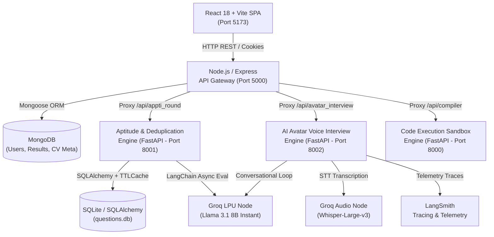
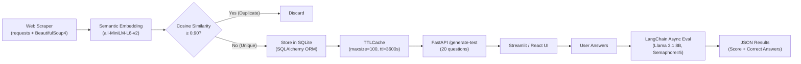
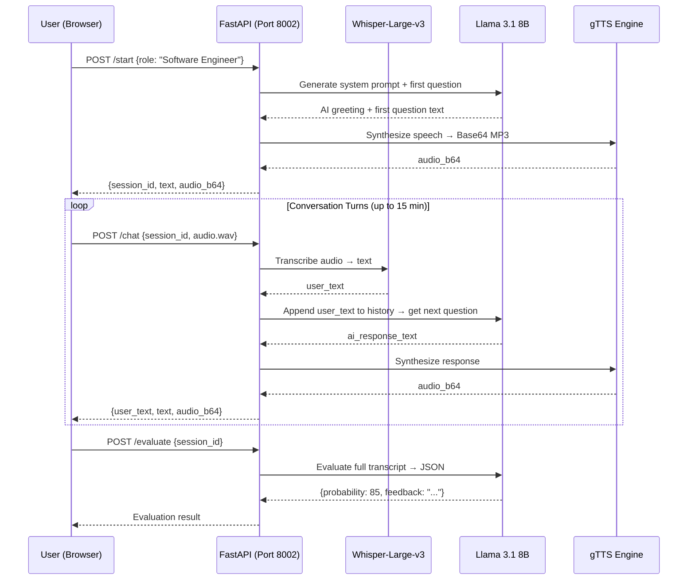
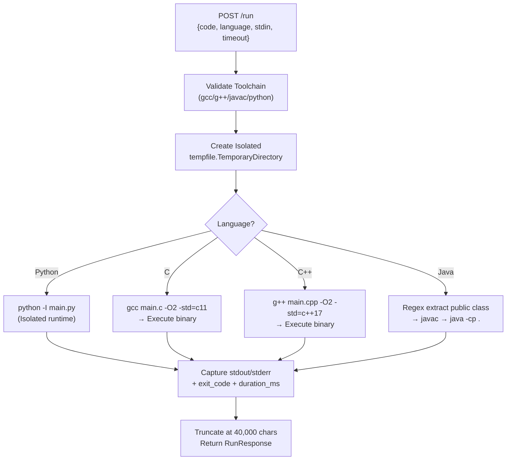

# PrepView: An AI-Powered Microservices Platform for End-to-End Technical Recruitment Preparation

## Research Paper Overview & Comprehensive Project Analysis

---

## 1. Abstract (Suggested)

> PrepView is an integrated, AI-driven web platform that consolidates the full spectrum of technical recruitment preparation into a single system. The platform employs a **microservices architecture** with a centralized Node.js API gateway routing traffic to three specialized Python FastAPI services: (1) an **LLM-evaluated aptitude testing engine** with **transformer-based semantic deduplication**, (2) a **real-time voice-driven AI mock interview system** using Automatic Speech Recognition and Text-to-Speech synthesis, and (3) a **sandboxed multi-language code execution engine**. The system leverages **Sentence-BERT dense embeddings** (all-MiniLM-L6-v2) for 384-dimensional semantic duplicate detection, **Meta LLaMA 3.1** running on Groq's Tensor Streaming Processor for lightning-fast inference, and **OpenAI Whisper-Large-v3** for speech transcription. This paper presents the architecture, design decisions, AI/ML pipeline mechanics, and anti-cheat mechanisms powering each subsystem.

---

## 2. Problem Statement & Motivation

Traditional placement preparation is fragmented across disconnected tools:
- **Aptitude practice** → Generic quiz sites with no company-specific targeting or intelligent deduplication
- **Mock interviews** → Human-dependent, expensive, and not scalable
- **Coding practice** → Requires external IDEs with no integrated test-case validation
- **Resume analysis** → Manual review with no AI-driven skill extraction

**PrepView unifies all four pillars** into a single authenticated platform with AI evaluation, gamification (streaks, badges, placement readiness scores), and company-specific preparation tracks (TCS, Infosys, Wipro, Amazon).

---

## 3. Problem Formulation and Research Objectives

### 3.1 Problem Definition

Technical recruitment preparation for undergraduate engineering candidates is typically characterized by high fragmentation, unvalidated practice material, and subjective evaluation. Specifically, existing preparation tools exhibit three major systemic deficiencies:

1. **Content Redundancy & Repository Contamination**: Large-scale scraping or crowd-sourcing of technical aptitude questions inherently introduces duplicate and paraphrased items. Without semantic deduplication, repositories become saturated with near-identical questions, degrading diagnostic assessment efficacy and wasting computational storage.
2. **Evaluation Scalability & Subjectivity Bottlenecks**: High-fidelity interview practice requires conversational, multi-turn dialogues evaluating both core technical competency (OOP, DBMS, Networks) and soft skills (communication, behavioral responses). Human mock interviews lack scalability and suffer from inter-rater variance, while standard online quizzes lack natural vocal interaction.
3. **Architectural Isolation Across Preparation Verticals**: Candidate preparation workflows require continuous interleaving between quantitative problem-solving, live code compilation, and behavioral interviews. Isolated monolithic applications cannot support heterogeneous computational profiles (e.g., CPU-bound language sandboxing alongside GPU/LPU-accelerated neural inference) with uniform reliability and rate governance.

**PrepView addresses these challenges** by formulating an integrated, microservices-driven ecosystem that combines dense semantic embeddings for repository hygiene, deterministic LLM evaluation agents for interview scoring, and sandboxed isolated execution environments.

### 3.2 Research Questions

To rigorously evaluate the efficacy, validity, and computational feasibility of the proposed system, we investigate the following research questions:

* **RQ1 (Semantic Deduplication)**: *How effectively can dense transformer embeddings (Sentence-BERT) identify and filter semantically duplicate aptitude questions compared to traditional exact-matching and token-overlap baselines?*
* **RQ2 (AI-Assisted Evaluation Agreement)**: *How closely does deterministic AI-based interview evaluation agree with structured human recruitment rubrics, and what level of scoring consistency can be achieved across repeated evaluations?*
* **RQ3 (Microservices Reliability & Workflow Integration)**: *How efficiently and reliably can the proposed heterogeneous microservices architecture execute end-to-end recruitment preparation workflows within measured latency, concurrency, and security constraints?*

### 3.3 Proposed Research Hypotheses

These questions yield three empirical hypotheses to be validated through systematic experimentation:

* **H1 (Embedding Superiority over Lexical Baselines)**: Sentence-BERT dense vector representations (`all-MiniLM-L6-v2`) with cosine similarity thresholding ($\tau \ge 0.90$) achieve statistically superior duplicate detection recall over surface-level exact string matching and bag-of-words (Jaccard / TF-IDF) baselines, successfully isolating paraphrased and reworded questions without discarding distinct items.
* **H2 (Measurable Evaluator Consistency & Rubric Alignment)**: Setting the LLM temperature parameter to zero ($\mathcal{T} = 0.0$) alongside Pydantic schema validation enables deterministic, zero-variance scoring across identical candidate transcripts, achieving high structural alignment with multi-dimensional human evaluation criteria across technical and behavioral dimensions.
* **H3 (Architectural Decoupling & Operational Resilience)**: An API Gateway–orchestrated microservices architecture with dedicated concurrency control primitives (thread pools, async semaphores, sliding-window rate limiting) can sustain complete multi-stage preparation workflows while maintaining process isolation and zero cross-service failure cascading.

---

## 4. System Architecture

### 3.1 High-Level Topology

### 3.2 Microservice Networking

| Service | Technology | Port | Responsibility |
|:--------|:-----------|:-----|:---------------|
| **API Gateway** | Node.js / Express | 5000 | Auth, rate limiting, session mgmt, reverse proxy |
| **Aptitude Engine** | Python / FastAPI | 8001 | Question generation, LLM evaluation, deduplication |
| **Avatar Interview** | Python / FastAPI | 8002 | Voice interview loop (ASR → LLM → TTS) |
| **Code Compiler** | Python / FastAPI | 8000 | Sandboxed code execution (C/C++/Java/Python) |
| **Frontend** | React 18 / Vite | 5173 | SPA with client-side routing, anti-cheat hooks |
| **Database** | MongoDB | 27017 | User profiles, test results, interview results |

The gateway uses `http-proxy-middleware` to seamlessly forward requests to each Python microservice while handling cross-cutting concerns (authentication, rate limiting, CORS) centrally.

---

## 5. Core Modules — Detailed Analysis

---

### 4.1 Module 1: AI Aptitude Testing & Semantic Deduplication Engine

#### 4.1.1 Data Pipeline

#### 4.1.2 Semantic Deduplication — The ML Core

This is the most research-worthy component. The system prevents database pollution using **dense semantic vector matching** rather than exact string comparison:

1. **Embedding Generation**: Each question is encoded into a **384-dimensional dense vector** using the `all-MiniLM-L6-v2` Sentence Transformer model (a distilled Siamese BERT network):

$$\vec{v} = f_{\theta}(\text{question\_text}) \in \mathbb{R}^{384}$$

2. **Cosine Similarity Deduplication**: For each incoming question embedding $\vec{a}$, it is compared against all existing database embeddings $\vec{b}$:

$$\text{Similarity}(\vec{a}, \vec{b}) = \frac{\vec{a} \cdot \vec{b}}{\|\vec{a}\| \|\vec{b}\|}$$

3. **Decision**: Questions with similarity ≥ 0.90 are flagged as semantic duplicates and discarded, even if worded differently.

> [!IMPORTANT]
> This approach catches paraphrased duplicates that exact string matching would miss — e.g., "What is the sum of first 10 natural numbers?" vs "Find the total of natural numbers from 1 to 10."

#### 4.1.3 LLM Evaluation Pipeline

- Uses **LangChain** with `PromptTemplate` + `JsonOutputParser` + Pydantic schema enforcement
- Answers are evaluated by `llama-3.1-8b-instant` on Groq's LPU (temperature=0.0 for deterministic evaluation)
- Async parallel processing with `asyncio.gather()` throttled by `asyncio.Semaphore(5)` to respect API rate limits
- Fallback mechanism returns a graceful error response if the LLM fails

#### 4.1.4 Key Source Files

| File | Role |
|:-----|:-----|
| [`ml_scraper.py`](file:///c:/Users/HEMANTA%20GHOSH/Desktop/PrepView/appti_round/scraper/ml_scraper.py) | Web scraping + ML deduplication pipeline |
| [`llm_agent.py`](file:///c:/Users/HEMANTA%20GHOSH/Desktop/PrepView/appti_round/backend/llm_agent.py) | LLM evaluation chain + question generation |
| [`database.py`](file:///c:/Users/HEMANTA%20GHOSH/Desktop/PrepView/appti_round/backend/database.py) | SQLAlchemy ORM + SQLite connection |
| [`main.py`](file:///c:/Users/HEMANTA%20GHOSH/Desktop/PrepView/appti_round/backend/main.py) | FastAPI endpoints (/generate-test, /evaluate-test) |
| [`app.py`](file:///c:/Users/HEMANTA%20GHOSH/Desktop/PrepView/appti_round/frontend/app.py) | Streamlit frontend with JS countdown timer |

---

### 4.2 Module 2: AI Avatar Conversational Voice Interview System

#### 4.2.1 Interaction Loop

#### 4.2.2 Technical Highlights

| Aspect | Implementation |
|:-------|:---------------|
| **ASR Model** | OpenAI `Whisper-Large-v3` via Groq Audio API |
| **LLM Backbone** | `llama-3.1-8b-instant` (temp=0.5, max_tokens=250) |
| **TTS Engine** | Google Text-to-Speech (`gTTS`) → Base64 MP3 |
| **Concurrency** | `ThreadPoolExecutor(max_workers=10)` + `asyncio.Semaphore(10)` |
| **Observability** | LangSmith `@traceable` decorators on all AI functions |
| **Session Mgmt** | In-memory dict keyed by UUID session IDs |
| **Evaluation** | Full transcript analysis → selection probability (0–100%) + feedback |

#### 4.2.3 Persona Engineering

The system generates role-specific interview prompts covering:
- OOP, DBMS, Computer Networks (technical)
- Standard HR questions for freshers
- Project-specific technology deep-dives
- One question at a time, conversational pacing

#### 4.2.4 Key Source Files

| File | Role |
|:-----|:-----|
| [`ai_service.py`](file:///c:/Users/HEMANTA%20GHOSH/Desktop/PrepView/avatar_interview/backend/ai_service.py) | Groq client, Whisper transcription, gTTS, LangSmith tracing |
| [`main.py`](file:///c:/Users/HEMANTA%20GHOSH/Desktop/PrepView/avatar_interview/backend/main.py) | FastAPI endpoints (/start, /chat, /evaluate), thread pool |

---

### 4.3 Module 3: Multi-Language Code Execution Sandbox

#### 4.3.1 Execution Pipeline

#### 4.3.2 Security & Performance Controls

- **Workspace Isolation**: Each execution creates a fresh `tempfile.TemporaryDirectory(prefix="code-runner-")` that is auto-cleaned
- **Python Isolation**: Uses `-I` flag to isolate from host PYTHONPATH
- **Timeout Enforcement**: `subprocess.TimeoutExpired` traps infinite loops
- **Output Truncation**: `MAX_OUTPUT_CHARS = 40,000` prevents memory exhaustion
- **Performance Profiling**: `time.perf_counter()` returns millisecond-accurate `duration_ms`
- **Java Class Detection**: Regex `\bpublic\s+class\s+([A-Za-z_$][\w$]*)` auto-extracts the main class name

#### 4.3.3 Supported Languages & Compilation Flags

| Language | Compiler | Flags |
|:---------|:---------|:------|
| Python | CPython | `-I` (isolated mode) |
| C | GCC | `-O2 -std=c11` |
| C++ | G++ | `-O2 -std=c++17` |
| Java | Javac/JVM | Auto class-name extraction |

#### 4.3.4 Key Source Files

| File | Role |
|:-----|:-----|
| [`runner.py`](file:///c:/Users/HEMANTA%20GHOSH/Desktop/PrepView/compiler/app/runner.py) | Core execution logic (327 lines) |
| [`models.py`](file:///c:/Users/HEMANTA%20GHOSH/Desktop/PrepView/compiler/app/models.py) | Pydantic request/response schemas |
| [`main.py`](file:///c:/Users/HEMANTA%20GHOSH/Desktop/PrepView/compiler/app/main.py) | FastAPI endpoint (POST /run) |

---

### 4.4 Module 4: API Gateway, Authentication & User Management

#### 4.4.1 Security Infrastructure

| Feature | Implementation |
|:--------|:---------------|
| **Rate Limiting** | In-memory sliding window `Map`, 200 req/IP/15min, auto-cleared via `setInterval` |
| **HTTP Security** | `helmet` middleware (CSP, X-Frame-Options, etc.) |
| **Password Hashing** | `bcryptjs` with salt factor 12 |
| **JWT Tokens** | `jsonwebtoken` for stateless authentication |
| **OAuth 2.0** | Passport.js strategies for Google, GitHub, Twitter |
| **Session Cookies** | HttpOnly, Secure (production), SameSite=Lax, 7-day expiry |
| **CORS** | Whitelist `CLIENT_URL` with credential passing |

#### 4.4.2 User Data Model (MongoDB)

The User schema tracks:
- Authentication (name, email, password hash, OAuth provider)
- **Gamification**: `streak` (daily consecutive logins), `badges` (7-day, 30-day streak awards), `placementScore` (cumulative AI-calculated readiness)
- **Activity Metrics**: `totalPractices`, `aptitudeTestsTaken`, `interviewsTaken`
- **Skills**: Array extracted from resume upload
- **CV Storage**: File path to uploaded PDF

#### 4.4.3 Key Source Files

| File | Role |
|:-----|:-----|
| [`server.js`](file:///c:/Users/HEMANTA%20GHOSH/Desktop/PrepView/backend/server.js) | Express gateway, proxy config, middleware stack |
| [`evaluationController.js`](file:///c:/Users/HEMANTA%20GHOSH/Desktop/PrepView/backend/controllers/evaluationController.js) | Orchestrates Python microservice calls + MongoDB persistence |
| [`cvRoutes.js`](file:///c:/Users/HEMANTA%20GHOSH/Desktop/PrepView/backend/routes/cvRoutes.js) | PDF resume upload (multer, 5MB limit) |

---

### 4.5 Module 5: Anti-Cheat System & Frontend

#### 4.5.1 Client-Side Proctoring

The [`useAntiCheat.js`](file:///c:/Users/HEMANTA%20GHOSH/Desktop/PrepView/frontend/src/hooks/useAntiCheat.js) React hook implements a **three-strike proctoring system**:

| Detection | Mechanism | Action |
|:----------|:----------|:-------|
| Tab Switching | `visibilitychange` event | Warning + strike |
| Fullscreen Exit | `fullscreenchange` event | Warning + strike, auto re-request fullscreen |
| Copy/Paste | `copy`/`paste` event prevention | Warning + strike |
| Right Click | `contextmenu` prevention | Blocked silently |
| **3rd Strike** | Auto-submit trigger | Test forcefully submitted |

#### 4.5.2 Problem Databank

The project includes a curated dataset of **70+ LeetCode-style coding problems** organized by company:
- **Amazon** (15 problems): 3Sum, N-Queens, Permutations, etc.
- **TCS** (16 problems): Binary Search, Climbing Stairs, Sliding Window, etc.
- **Infosys** (15 problems): Combination Sum, Median of Two Sorted Arrays, etc.
- **Wipro** (28 problems): Group Anagrams, Kth Largest Element, etc.

Each problem JSON includes description, constraints, examples, and test cases with inputs/expected outputs.

---

## 6. Technology Stack Summary

### 5.1 AI/ML Models Used

| Model | Type | Purpose | Dimensionality / Params |
|:------|:-----|:--------|:------------------------|
| `all-MiniLM-L6-v2` | Sentence Transformer (Siamese BERT) | Semantic deduplication via dense embeddings | 384-dimensional vectors |
| `llama-3.1-8b-instant` | Large Language Model (Meta) | Question evaluation, interview conversation, performance scoring | 8B parameters |
| `whisper-large-v3` | Automatic Speech Recognition (OpenAI) | Voice-to-text transcription | 1.5B parameters |

### 5.2 Frameworks & Libraries

| Layer | Technologies |
|:------|:-------------|
| **Frontend** | React 18, Vite, React Router, Axios, Tailwind CSS, Firebase Auth, Streamlit |
| **API Gateway** | Node.js, Express.js, Passport.js, Helmet, http-proxy-middleware |
| **Microservices** | FastAPI, Uvicorn, Pydantic |
| **AI/ML Orchestration** | LangChain, langchain-groq, sentence-transformers, gTTS |
| **Databases** | MongoDB (Mongoose), SQLite (SQLAlchemy) |
| **Observability** | LangSmith |
| **Compilers** | GCC, G++, OpenJDK Javac/JVM, CPython |

---

## 7. Research Paper References

| # | Paper | Relevance |
|:--|:------|:----------|
| 1 | [Sentence-BERT: Sentence Embeddings using Siamese BERT-Networks (Reimers & Gurevych, 2019)](https://arxiv.org/abs/1908.10084) | Foundation for `all-MiniLM-L6-v2` semantic embeddings |
| 2 | [MiniLM: Deep Self-Attention Distillation (Wang et al., 2020)](https://arxiv.org/abs/2002.10957) | Model distillation technique used in MiniLM |
| 3 | [The Llama 3 Herd of Models (AI@Meta, 2024)](https://arxiv.org/abs/2407.21783) | Architecture of `llama-3.1-8b-instant` |
| 4 | [Groq Tensor Streaming Processor (Abts et al., ISCA 2020)](https://arxiv.org/abs/2002.05815) | Hardware accelerator running the LLM inference |
| 5 | [ReAct: Synergizing Reasoning and Acting in LLMs (Yao et al., ICLR 2023)](https://arxiv.org/abs/2210.03629) | Agentic prompt engineering paradigm |
| 6 | [Robust Speech Recognition via Large-Scale Weak Supervision (Radford et al., 2022)](https://arxiv.org/abs/2212.04356) | Whisper ASR model architecture |
| 7 | [Evaluating Large Language Models: A Comprehensive Survey (Chang et al., 2023)](https://arxiv.org/abs/2307.03109) | LLM evaluation methodology |
| 8 | [Microservices: Yesterday, Today, and Tomorrow (Dragoni et al., 2017)](https://arxiv.org/abs/1606.04050) | Microservice architecture pattern |
| 9 | [RFC 7519: JSON Web Token (JWT)](https://datatracker.ietf.org/doc/html/rfc7519) | Authentication token standard |
| 10 | [Google gVisor Sandbox (USENIX ATC '23)](https://www.usenix.org/conference/atc23/presentation/young) | Code execution sandboxing reference |

---

## 8. Novel Contributions (for the Paper)

1. **Hybrid Deduplication Pipeline**: Combines web scraping with real-time Sentence-BERT cosine similarity thresholding (0.90) for intelligent question deduplication — not found in existing quiz platforms.

2. **End-to-End Voice Interview Loop**: A complete ASR → LLM Reasoning → TTS pipeline with structured JSON evaluation and selection probability scoring, instrumented with production-grade tracing (LangSmith).

3. **Unified Microservices Architecture**: A single API gateway orchestrating three heterogeneous Python AI services, each addressing a distinct recruitment preparation vertical, with centralized auth, rate limiting, and gamification.

4. **Anti-Cheat Proctoring**: A client-side three-strike fullscreen enforcement system with auto-submission, addressing integrity in online assessment scenarios.

5. **Company-Specific Preparation Tracks**: Curated problem databanks and AI-generated aptitude tests tailored to specific companies (TCS, Infosys, Wipro, Amazon), a unique personalization axis.

---

## 9. Suggested Paper Structure

1. **Introduction** — Problem statement, motivation, related work
2. **Literature Review** — Existing platforms (LeetCode, HackerRank, Pramp), gaps identified
3. **System Architecture** — Microservices topology, API gateway design, database schema
4. **Module Design & Implementation**
   - 4.1 Semantic Deduplication Engine (ML pipeline)
   - 4.2 AI Voice Interview System (ASR + LLM + TTS)
   - 4.3 Code Execution Sandbox (security model)
   - 4.4 Gamification & Anti-Cheat
5. **Experimental Evaluation** — Deduplication accuracy, LLM eval quality, latency benchmarks
6. **Results & Discussion**
7. **Conclusion & Future Work** — Vector DB migration (FAISS/Chroma), NLP resume parsing, containerized sandboxing (Docker/gVisor)
